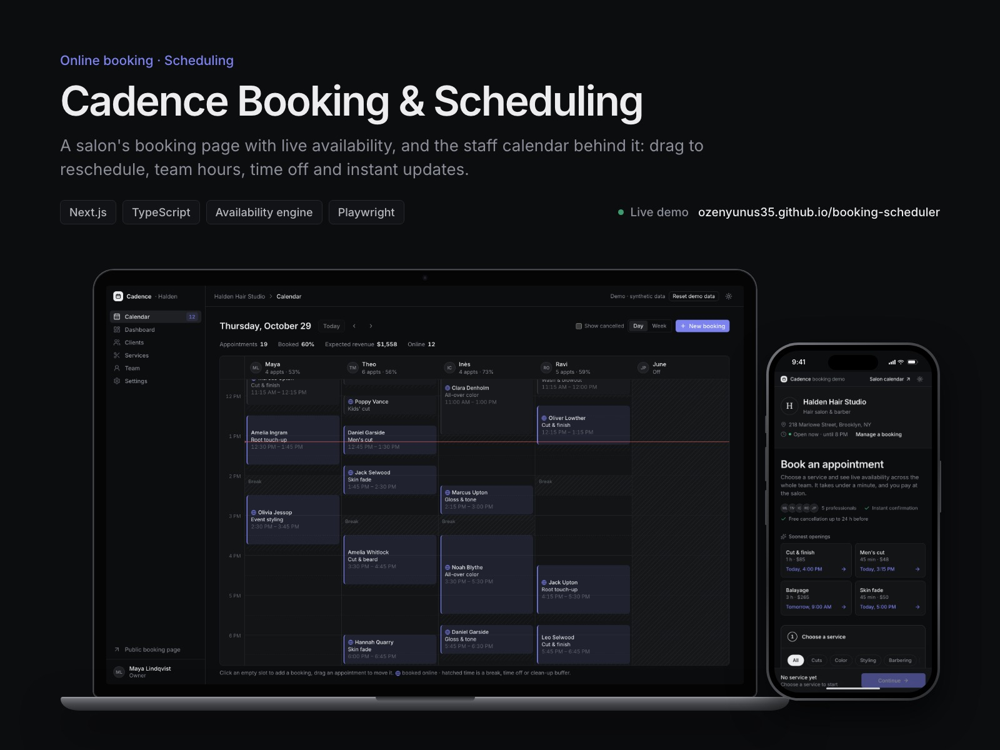
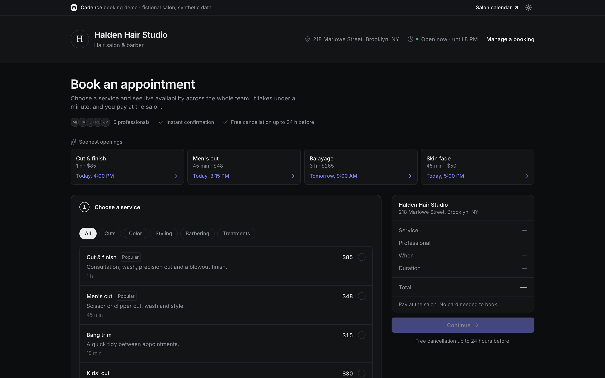
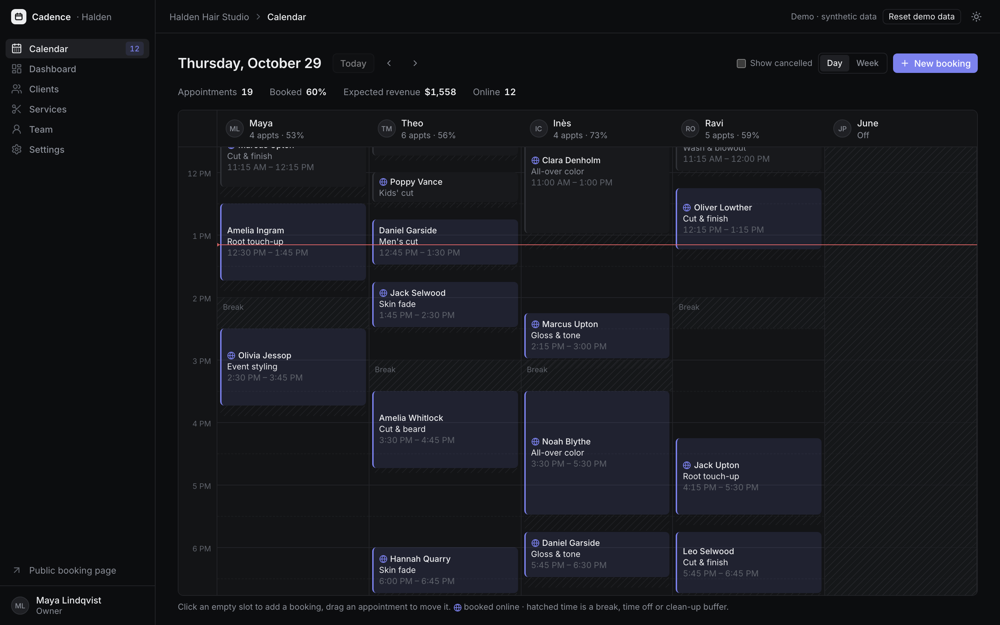
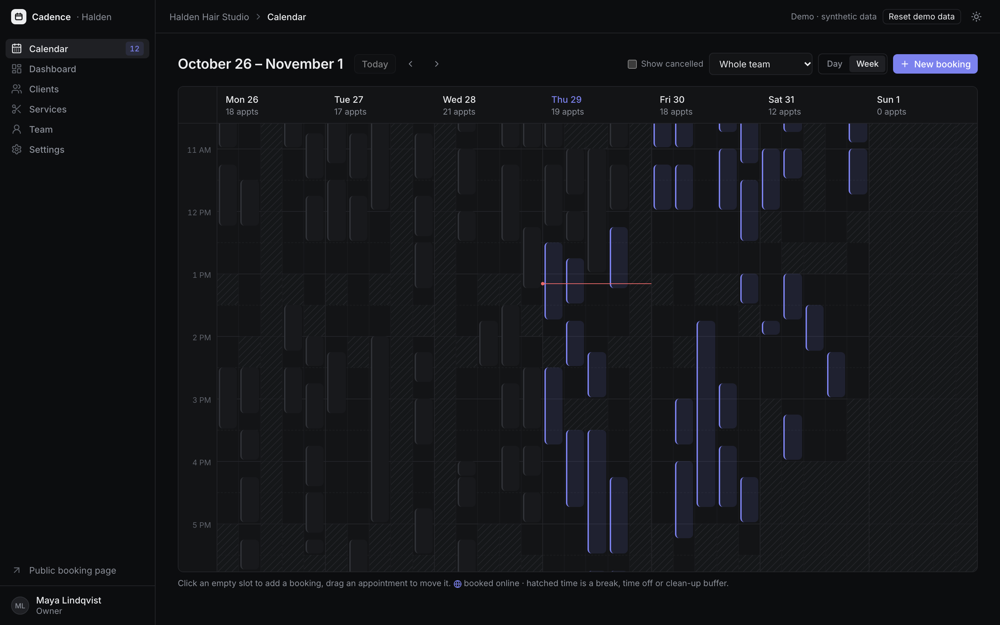
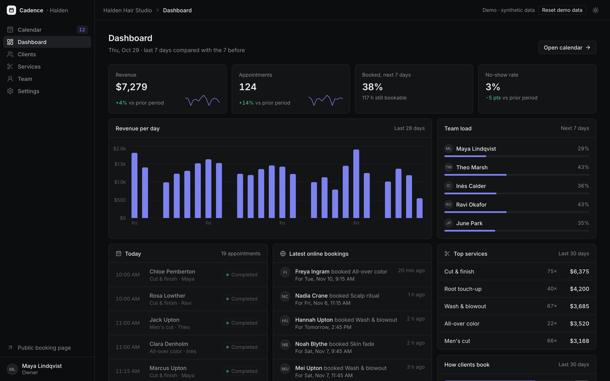
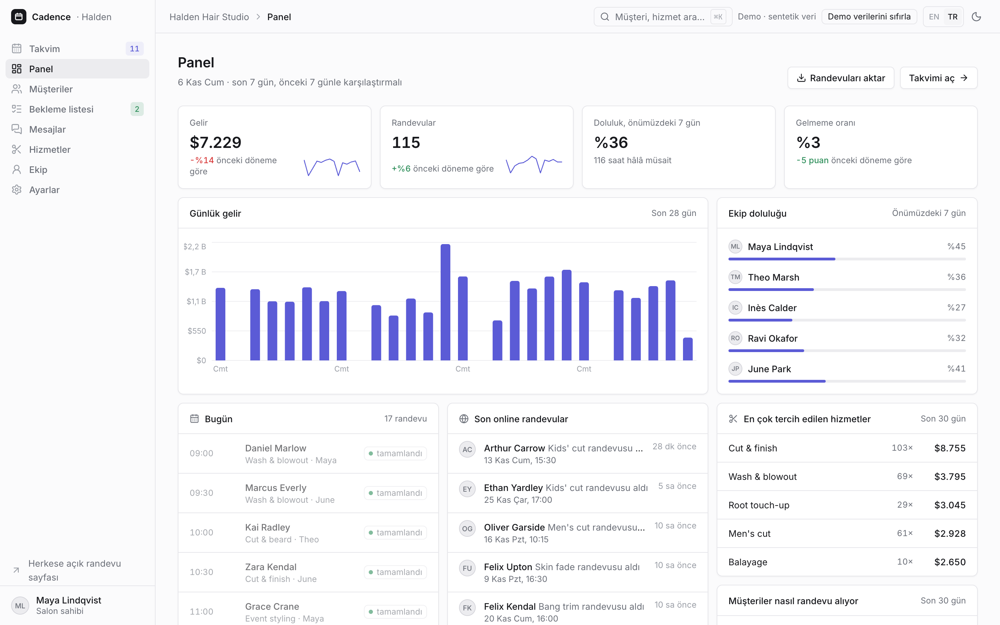
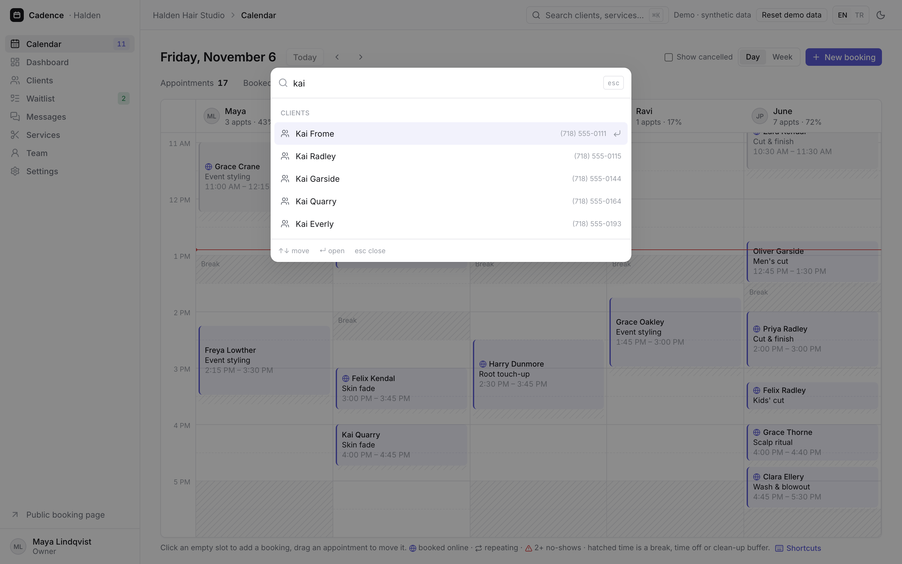
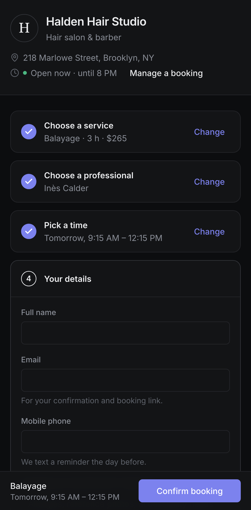

# Cadence: Online Booking & Scheduling

A salon's public booking page that only offers times that are really free, and the staff calendar behind it.
Clients pick a service, a person (or "any professional") and a time, then get a confirmation with a calendar file
and a link to reschedule or cancel. The team works from a day/week calendar with a column per person, drags
appointments to move them, and manages services, working hours, time off and booking rules.

**Live demo:** https://ozenyunus35.github.io/booking-scheduler/



> **This is a demo.** Halden Hair Studio is a fictional salon in Brooklyn, and its team, clients and bookings are
> synthetic (emails use the reserved `.example` domain, phone numbers are 555-01xx). There is no server: data is
> kept in your browser's localStorage and regenerated around today's date each new day. Use **Reset demo data**
> in the salon calendar to start over.

## Try it

1. Open the live demo and book something: pick one of the **soonest openings**, or a service, a professional and
   a time. Only free times are shown, worked out from hours, breaks, time off and existing bookings.
2. On the confirmation, download the calendar file or open **Reschedule or cancel**.
3. Open the **salon calendar** in a second tab, then book again from the first tab. The booking appears in the
   calendar straight away, with a notification.
4. In the calendar, drag an appointment to another time or person, or click an empty slot to add a phone booking.
5. Change a price, someone's hours or the minimum notice in the admin: the booking page uses it immediately.
6. Pick a color and add a cut to the same visit, then open a full day and **join the waitlist**. The salon's
   **Waitlist** page shows you, and once something frees up it offers the open times with one-click booking.
7. In the calendar, add a phone booking that **repeats** every few weeks: the form previews every date, moves the
   ones that clash to the nearest free time and skips what can't fit. Open **Messages** to see every email and
   text the salon would send, and the reminders due in the next two days.

## Features

**Booking page (for clients)**
- Services by category with duration and price, "soonest openings" shortcuts for popular services.
- Professional picker with each person's next free time, plus "any professional" (the least busy free person
  gets the booking).
- Date strip with availability per day and free times grouped into morning, afternoon and evening.
- Details form with validation, confirmation with a booking reference, `.ics` calendar file with a reminder.
- Manage page: a private link (a random token, no personal data in the URL) or reference + email lookup;
  reschedule and cancel online until the cancellation window closes.
- If someone else books your chosen time in another tab, the page notices and asks you to pick another one.
- One visit, several services: add a cut or a blowout after a color, and only the people who do all of them,
  and times long enough for the whole visit, are offered. Price and duration add up.
- Waitlist on full days: pick the part of the day that works and get a text when a time opens up.
- Mobile-first layout with a sticky summary bar, dark and light themes.

**Salon calendar and admin**
- Day view with a column per staff member: breaks, time off and clean-up buffers shown as hatched time, the
  current time line, booked-online markers, and a summary of the day (appointments, booked share, revenue).
- Drag and drop to move appointments between times and people, with a live preview that says why a slot doesn't
  work ("Theo is on a break at that time"). Click an empty slot to add a booking.
- Week view for the whole team or one person. Booking details with status (completed, no-show, cancel) and
  reschedule.
- Dashboard: revenue, appointments, booked share of the next 7 days, no-show rate, revenue per day, team load,
  today's agenda, latest online bookings, top services and how clients book.
- Clients: search, sort, visit history, totals and notes. Services editor (duration, buffer, price, who offers it).
  Team: weekly hours with breaks, whole-day and part-day time off with a warning about affected bookings.
  Settings: slot step, minimum notice, booking window and cancellation window.
- Repeating appointments every 2 to 8 weeks with a preview of every date (booked, moved to the nearest free time,
  or skipped with the reason), one email for the whole series, and "cancel this and later".
- Waitlist page: everyone waiting, which of them now has a free time, and one-click booking. A cancellation or a
  move texts the people waiting for that day, at most once an hour each.
- Messages: every confirmation, change, cancellation, series and waitlist email or text the salon would send, with
  the full text, plus the reminder texts due in the next two days.
- CSV exports of clients and bookings (quoted, formula-safe, UTF-8 with a BOM for Excel), a warning icon on clients
  with two or more no-shows, and keyboard shortcuts in the calendar (T, ← →, D, W, N, ?).
- English and Turkish salon console: every page, status and message, with 24-hour times, Turkish dates and amounts
  in Turkish mode. The public booking pages and the texts sent to clients stay in English, since Halden is a Brooklyn salon.
- A ⌘K command palette: jump to any page, open any client (search by name, email or phone), find a service or a team
  member, reset the demo, switch theme or language. Clients can be linked with `/admin/clients/?c=…`.

| Booking page | Salon calendar |
| --- | --- |
|  |  |
| **Week view** | **Dashboard** |
|  |  |
| **Console in Turkish** | **Command palette** |
|  |  |

<p align="center"></p>

## How availability works

Everything is in [`src/lib/availability.ts`](src/lib/availability.ts). Times are minutes after midnight in the
salon's time zone and dates are salon dates, so the result never depends on the visitor's clock.

A start time is bookable for a person when:

1. they offer the service and work that day (no whole-day time off),
2. the appointment fits inside their hours and misses their breaks and part-day time off,
3. the appointment plus its clean-up buffer misses every live booking plus that booking's buffer,
4. for online booking, it is at least the minimum notice away, measured in real time (a one-day notice also
   closes tomorrow morning), and inside the booking window.

Start times sit on the slot-step grid from the start of each person's day, and an online booking has to use one;
the salon's own calendar can book any minute. A rescheduled booking keeps its own length, even if the service got
shorter or longer since. Every booking change also checks its input (a real date, a whole minute, a service still
offered, contact details the form would accept), and an online booking never overwrites the name or phone of a
client already on file: details that differ are added to the booking's notes for the salon to check. "Any professional" merges everyone's
free times and records who is free at each one; when the client confirms, the time is checked again and given to
the free person with the fewest booked minutes that day. `checkSlot` returns the reason a time doesn't work, which
the calendar shows while dragging. Salon wall-clock times are converted to real instants (for "today", the notice
period and the `.ics` file) with `Intl`, including the DST change.

### In production

| Demo | Production |
| --- | --- |
| localStorage state, `storage` events between tabs | A database (PostgreSQL) and WebSockets or Server-Sent Events for live calendar updates |
| Availability checked in the browser | The same engine on the server, with the final check and insert in one transaction so two clients can't take the same time |
| Outbox listed on the Messages page | The same messages handed to an email and SMS provider (Resend, Twilio), with the `.ics` attached and delivery status |
| Waitlist texts say "call us" | A reply link that books the freed time for the first client who taps it |
| Manage link with a random token | A signed, expiring token |
| No payments | Optional deposits or no-show fees with Stripe |
| Single salon | Several locations, staff logins with roles, and Google Calendar sync |

## Run it locally

```bash
npm install
npm run dev          # http://localhost:3000
npm test             # unit tests (Vitest)
npm run build        # static export in out/
```

End-to-end tests run against the static build, served under `/booking-scheduler/` like on GitHub Pages:

```bash
npx playwright install chromium webkit
PAGES_BASE_PATH=/booking-scheduler npm run build
npm run test:e2e     # desktop Chrome, desktop Safari (WebKit), iPhone, Android
BASE_URL=https://ozenyunus35.github.io/booking-scheduler/ npm run test:e2e   # against the live site
```

## Tests

- **Unit (Vitest):** working hours, breaks, whole-day and part-day time off, buffers on both sides, cancelled
  bookings, rescheduling, minimum notice, booking window, salon time zone versus UTC, DST conversion, "any
  professional" merging and assignment, reasons for unavailable times, booking, double-booking protection, client
  matching, cancellation window, `.ics` output (escaping and line folding), seed integrity (no overlaps, no client
  in two chairs at once, synthetic contacts), input checks and dashboard maths. Visits with add-ons (duration,
  price, buffer, who can do them), the waitlist (checks, texts only for times that suit, once, booking from it),
  repeating series (plan, move, skip, one email, cancel from a date), the outbox cap, reminders and CSV quoting.
- **End-to-end (Playwright, clock pinned to a Thursday morning):** booking, rescheduling and cancelling as a client,
  soonest openings, notice period, a time taken in another tab, lookup by reference, the salon calendar, a live
  booking arriving from another tab, phone bookings, drag to move, dashboard, clients, services, team and
  settings changes reaching the booking page, a visit with an add-on, joining the waitlist and booking from it, a
  repeating series, Messages, keyboard shortcuts and CSV downloads, theme, reset, and a check that no page scrolls
  sideways, on four browser/device profiles.

GitHub Actions runs lint, type check, unit and e2e tests on every push to `main`, then deploys to GitHub Pages.

## Tech

Next.js 16 (App Router, static export), React 19, TypeScript, Tailwind CSS 4, Recharts, Lucide icons, Vitest,
Playwright. MIT License.
